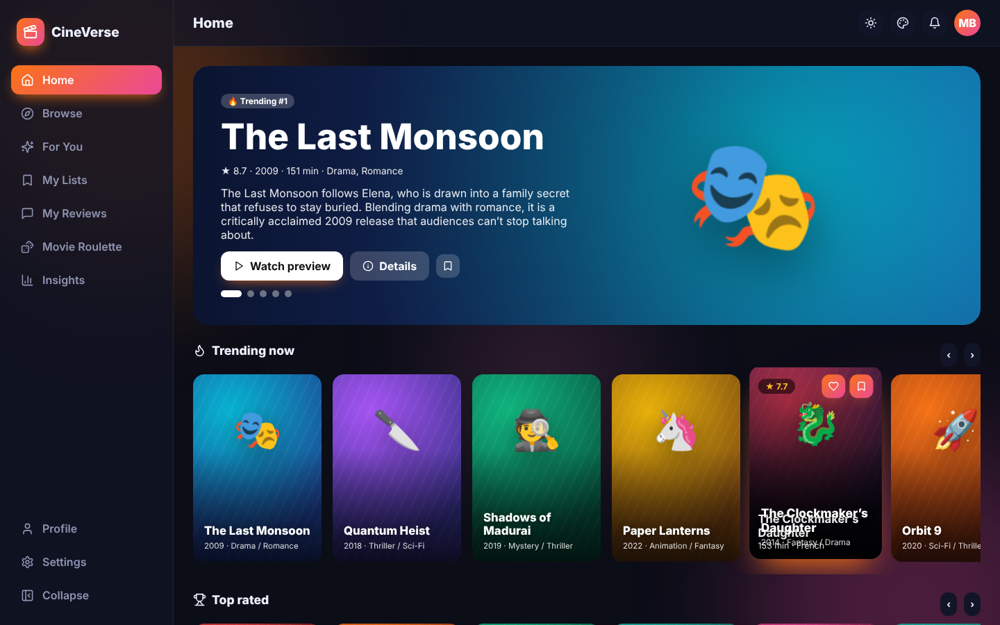
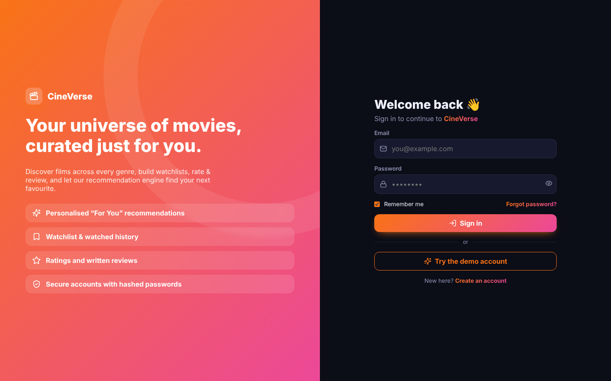
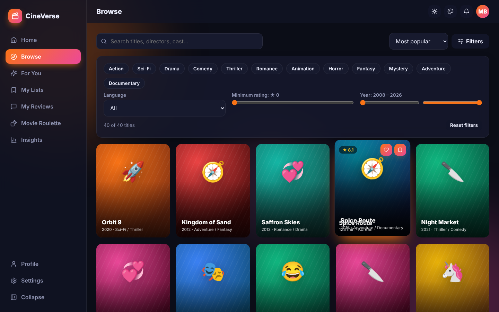
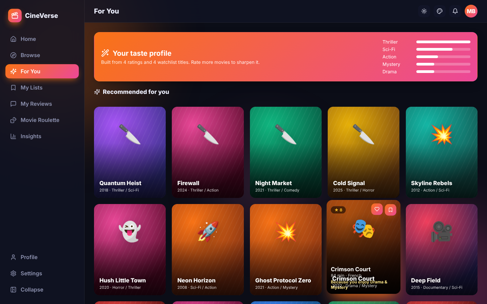

<div align="center">

# 🎬 CineVerse

### Movie discovery platform with smart recommendations, watchlists, reviews & a movie roulette


</div>



## ✨ Features

| Area | What you get |
|---|---|
| 🔐 **Auth** | Register & login with SHA-256 salted password hashing, password-strength meter, remember-me, demo account, protected routes, profile editing, password change, account deletion |
| 🏠 **Home** | Auto-rotating hero carousel, horizontally scrolling rows (Trending, Top rated, New releases, genre picks) with snap scrolling and arrow controls |
| 🔎 **Browse** | Full-text search across titles, directors & cast · multi-genre filter · language · minimum rating · year-range sliders · 5 sort modes |
| 🎞️ **Movie details** | Animated poster, metadata, cast & crew, animated “preview” player, 5-star rating, written reviews, *More like this* |
| ✨ **For You** | Content-based recommendation engine — genre affinity from your star ratings, watchlist and history, blended with quality & popularity; explains *why* each title is suggested |
| 📚 **My Lists** | Watchlist (drag-and-drop reordering, total runtime), Watched (inline re-rating) and Favourites |
| 📝 **My Reviews** | All your reviews with edit/delete |
| 🎡 **Movie Roulette** | Spinning wheel with genre & runtime filters picks tonight’s movie |
| 📊 **Insights** | Hours watched, average rating, genre donut, rating distribution, release-era bars |
| 🎨 **Themes** | Light / Dark / Midnight / Sepia / System · 6 accent gradients · radius slider · compact mode · motion toggle |
| 🎞️ **Animations** | Hover-lift cards with overlays, bobbing poster art, page transitions, staggered grids, equalizer preview, pop-in modals, toasts |

> The catalogue is an **original, procedurally generated** set of 40 fictional films with generated artwork, so the project contains no copyrighted posters.

## 🖼️ Screenshots

| Login | Browse | For You |
|---|---|---|
|  |  |  |

## 🚀 Getting started

```bash
git clone https://github.com/PreciousBharath/CINEVERSE-MOVIE-DISCOVERY-APP.git
cd CINEVERSE-MOVIE-DISCOVERY-APP
npm install
npm run dev
```

Click **Try the demo account** (`demo@cineverse.app` / `Demo@1234`) or register.

## 🧱 Structure

```
src/
├── catalog.js     # Film catalogue generator + recommendation engine
├── library.jsx    # Per-user watchlist, watched, favourites, ratings, reviews
├── auth.jsx · theme.jsx · toast.jsx · storage.js
├── components/    # Movie (Poster, MovieCard, MovieModal, Row, Stars), Layout, ThemePanel…
└── pages/         # Home, Browse, ForYou, Watchlist, Reviews, Roulette, Stats, Login, Register…
```

## 🛠️ Tech stack

React 18 · React Router 6 · Recharts · Lucide icons · Vite · HTML5 drag-and-drop · CSS animations · Web Crypto API · localStorage

## 📄 License

MIT © [Bharath](https://github.com/PreciousBharath)
